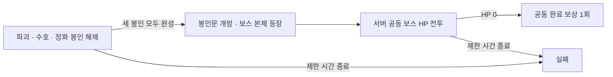

# 봉인전 UI 개편 및 봉인 → 보스 방식 검토

2026-10-21. 사용자가 봉인전 UI 전체 개편을 요청했고, 보상 삭제 범위를 **봉인전 공헌도 순위 보상**으로 정정했다.

## 이번 반영 범위

봉인 성소를 중심으로 세 역할의 공동 진행도 → 선택한 봉인 출전 → 내 원정대 준비 → 공동 완료 보상 순서로 화면을 재구성했다. PC는 역할/준비 정보를 나란히, 모바일은 한 열로 표시한다. 역할은 터치·클릭과 방향키/Home/End로 선택하며, 확인 창·공헌 기록은 키보드 초점 순환과 Escape 닫기를 지원한다. 수치와 안내는 실제 서버 응답을 DOM으로 표시한다.

배경, 문장 3종, 버튼, 패널을 내장 ImageGen으로 새로 제작했다. 패널은 9-slice로 확장하고 전용 버튼 이미지를 사용한다. 관리자 설정, 조회 실패, 미운영, 출전 확인, 보상 수령 안내도 같은 이미지 세트를 쓴다. 공용 V3 전장·카드 도크·봉인 수정구·전투 계산은 유지한다. 전투 리소스 준비 실패 시에는 참여 요청 전 중단해 도전 횟수를 소모하지 않는다.

- 자산/원본 해시 색인: `assets/ui/seal-battle/ritual-20261021/manifest.json`
- 정확한 생성 프롬프트/참조: `preview/seal-battle-rework-20261021/prompts.json`
- 생성 원본: `preview/seal-battle-rework-20261021/sources/`
- PC/390px/320px 화면 및 조작 검수: `preview/seal-battle-rework-20261021/qa/`
- 프리뷰: `preview/seal-battle-rework-20261021/index.html`, `admin.html` (예시 API 데이터, 실제 지급/저장 없음)

이미지·화면 기술 검수는 완료했으나 사용자 시각 승인으로 기록하지 않았다.

## 보상 삭제 범위

| 항목 | 처리 |
|---|---|
| 봉인전 공헌도 순위 보상 | 현재/지난 회차 모두 수령 종료. 구버전 `POST seal-battle/rank-reward`도 HTTP 410 및 `SEAL_RANK_REWARDS_RETIRED` 반환 |
| 오래된 CMS/회차의 순위 보상 설정 | 읽기/저장 시 OFF·빈 구간으로 정규화해 재활성화 차단 |
| 순위 보상 UI 및 CMS 편집 | 제거 |
| 공헌 순위 기록 | 기록 조회로 유지, 보상 없음 |
| 이미 지급한 보상·영수증·기존 회차 원본 | 회수·삭제·재정산하지 않음 |
| 참여 코인/조각·계급 경험치 | 기존 서버 정책 유지 |
| 공동 완료 보상 및 마스터의 별 | 회차에 저장된 값·최소 공격 횟수·미수령 보상 유지 |
| 월드 레이드 피해량 구간 보상 | 변경 없음 |

화면의 예시 금액은 검수 데이터이며 운영 설정을 덮어쓰지 않는다. 과거 일회성 복구 스크립트는 감사 이력으로 보존하며 재실행하지 않는다.

## 새 방식 검토: 세 봉인 해제 후 보스 본체 공개 권장

현재는 파괴·수호·정화 목표를 모두 채우는 순간 성공으로 끝난다. 새 방식은 **봉인을 여는 과정과 그 뒤의 최종 전투를 구분**하면 화면의 목적과 승리 순간이 분명해진다.

| 단계 | 플레이 방식 | 설계 의도 |
|---|---|---|
| 봉인 해제 | 기존 3역할 선택·공동 진행도·부족 역할 지원 보너스를 활용 | 참여자가 당장 필요한 역할을 선택 |
| 개방 연출 | 완료된 문장들이 봉인문에 모이고 보스 본체 공개. 동작 줄이기/건너뛰기 제공 | 단계 전환을 명확히 알림. 재접속으로 연출·보상을 중복 실행하지 않음 |
| 보스 본체 | 기존 PvE 덱/V3 전장으로 공격, 서버 공동 HP 감소 | 세 막대를 채운 뒤 분명한 최종 목표 제시 |
| 결과 | 회차 최소 공격 조건을 충족한 참여자에게 공동 완료 보상 | 순위 경쟁·피해량 구간 보상 없이 공동 성공에 집중 |

세 봉인을 순차 강제하는 방식은 후순위 역할 이용자의 대기를 늘린다. 기존처럼 세 역할을 자유롭게 진행하고 **모두 완성됐을 때 본체를 여는 방식**을 우선 권장한다. 첫 버전에서는 본체전 역할별 별도 기술을 추가하지 않고, 이후 필요하면 파괴(방어 약화)·수호(공격 억제)·정화(상태 해제)를 검토한다. 별도 기술은 추가 전투 규칙·검수가 필요하다.

### 도전 횟수와 보상

- 현재 도전 횟수/충전 시간을 두 단계에서 공용으로 쓰는 안을 권장한다. 전환 순간 자동 충전이나 무료 추가 공격을 만들지 않는다.
- 회차의 최소 공격 횟수는 두 단계 합산으로 판단하는 안이 자연스럽다. 앞 단계에 기여한 이용자가 본체 등장 때 접속하지 못했다고 완료 자격을 잃지 않게 한다.
- 봉인 해제만으로 별도 완료 보상을 지급하지 않고, 본체 처치 때 공동 완료 보상을 한 번 지급하는 안을 권장한다. 현재 참여 보상과 기존 완료 보상 정책을 출발점으로 삼는다.
- 본체 전투가 추가되면 총 공격 횟수와 참여 보상 발행량이 늘 수 있다. 현재 수치를 그대로 더하는 것만으로 난이도·발행량이 유지된다고 가정하지 않는다.

### 시간·난이도 조정 전에 확인할 자료

최근 회차의 역할별 완료 시각, 활성 참여자 수, 공격 수, 도전 횟수 소진과 충전 주기, 참여 보상 총액을 확인해야 한다. 봉인이 늦게 풀리면 본체와 싸울 시간이 없어지는 것이 가장 큰 위험이다. 봉인 목표와 본체 HP를 함께 조정하고, 전체 종료 시각과 남은 시간을 양 단계에서 일관되게 보여준다. 종료 시각 자동 연장은 기본 동작으로 넣지 않는다.

본체 HP·전투력·세 봉인의 새 목표·단계별 시간 배분·보상 변경은 **아직 미정**이다. 신규 CMS 값은 미입력 시 시작을 막아야 하며, 구현 때 검토 없이 임의 기본값을 운영에 적용하지 않는다.

### 구현 시 필요한 보호

1. 회차에 규칙 버전과 현재 단계, 본체 HP, 단계 전환 시각을 저장한다. 진행 중인 구회차는 현재 규칙으로 마무리하고 새 방식은 새 회차부터 적용한다.
2. 마지막 봉인 공헌과 본체 단계 전환을 같은 서버 거래에서 한 번만 처리한다. 동시에 들어온 요청으로 본체 HP가 재설정되지 않게 한다.
3. 단계 버전을 참여 요청에 포함한다. 이미 끝난 봉인 화면에서 보낸 새 요청은 차감 없이 갱신 안내한다. 기존 영수증 재시도는 원래 확정 결과를 반환한다.
4. 마지막 봉인 공격의 초과 공헌은 본체 피해로 자동 전환하지 않는다. 본체 마지막 공격과 완료 보상 자격 확정도 원자적으로 처리한다.
5. 클라이언트 연출·닫기·재접속은 서버 단계/HP/영수증을 재생할 뿐, 단계 전환이나 지급을 재판정하지 않는다.
6. 공동 상태 조회는 기존 규모의 집계로 제한하고, 전투 상세 타임라인을 장기 저장하지 않는다. 상태 전환·HP 갱신에는 동시성 검사가 필요하다.

**이번에는 검토만 완료했다.** 현재 게임의 세 봉인 완성 → 성공 규칙, 실제 전투 수치·기한·획득 경로는 변경하지 않았다. 본체전 도입은 별도 구현 범위다.

## 검증 및 배포 범위

SQLite/Postgres에서 구회차·동시 수령·재시도·구 CMS 입력 차단과 지급 이력/잔액 보존을 검증했다. 코인 보상과 완료 마스터의 별 회귀도 통과했다. 브라우저에서는 PC 1440px, 모바일 390px과 320px에서 이미지, 역할 클릭/터치/방향키, 취소, 공헌 기록 스크롤/분류, 완료/실패/덱 없음/도전 없음 상태, 관리자 저장 입력을 확인했다. 재화 검증은 격리 DB, UI 검증은 예시 API를 사용했으며 실제 계정에 검수용 보상을 지급하지 않았다.

봉인전 한 콘텐츠에 제한된 화면/보상 종료 변경으로 `npm run deploy:production -- --scoped`를 사용한다. DB 구조·공통 인증·V3 엔진 변경은 없다. 직전 운영 배포는 Cloudflare Pages 목록에서 확인한 `ad516cc9-1500-4894-b93c-93c695fad82e`, 커밋 `99120149ff676e033c2fffb748ed9c1cb2bc390c`이다. 이미 통과한 거래 검사를 중복 실행하지 않고 배포 게이트에서 남은 V3 수정구 연결·과거 복구 기록 회귀와 Worker 컴파일을 확인한다.

첫 배포 게이트에서 V3 연결·과거 복구 회귀 2개, Worker 문법, 출시 플래그/캐시, Hyperdrive 검사를 통과했다. 이후 정적 파일 20,021개로 호스팅의 20,000개 한도에서 중단됐다. 이번 봉인전의 원본·프롬프트·QA·제작 도구·문서는 Git에 보존하고 실제 WebP 6종·플레이어/CMS 코드·브라우저 프리뷰와 fixture를 전송하도록 패키징을 한정했다. 다른 콘텐츠 자산을 삭제하거나 한도를 우회하지 않는다. 재배포 게이트에는 새 `tests/seal-ui-delivery-20261021.test.mjs`로 원본 해시 보존, Pages/데스크톱 리소스 연결과 파일 수를 확인한다.
